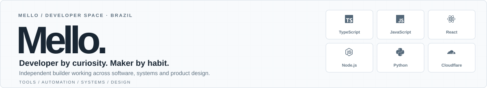
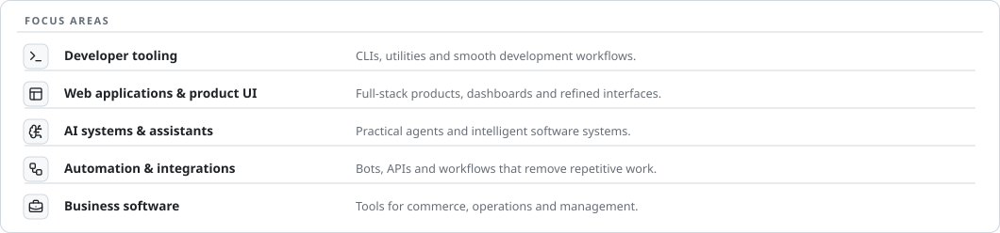
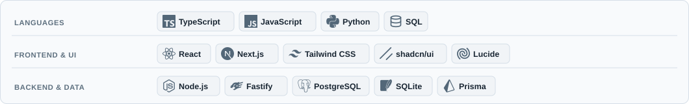
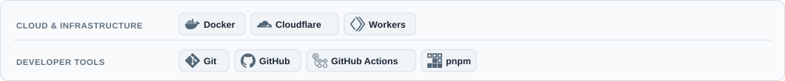
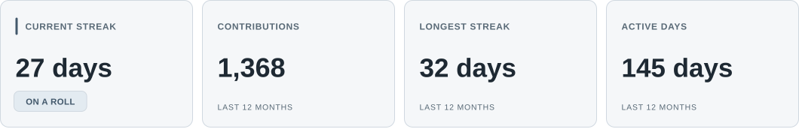
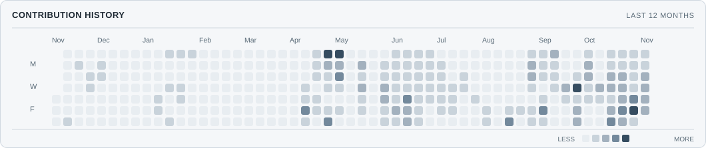

  <picture>
  <source media="(max-width: 640px) and (prefers-color-scheme: dark)" srcset="./assets/headers/hero-mobile-dark.svg">
  <source media="(max-width: 640px) and (prefers-color-scheme: light)" srcset="./assets/headers/hero-mobile-light.svg">
  <source media="(prefers-color-scheme: dark)" srcset="./assets/headers/hero-dark.svg">
  <source media="(prefers-color-scheme: light)" srcset="./assets/headers/hero-light.svg">
  
</picture>

  
<samp>developer &nbsp;·&nbsp; builder &nbsp;·&nbsp; brazil</samp>

  

    <a href="#about">about</a> &nbsp;·&nbsp;
    <a href="#what-i-build">build</a> &nbsp;·&nbsp;
    <a href="#tech-stack--tools">stack</a> &nbsp;·&nbsp;
    <a href="#ai--coding-workflow">agents</a> &nbsp;·&nbsp;
    <a href="#development-activity">activity</a>
  

### About

I'm Mello, an independent software developer and business owner based in Brazil. I build useful tools, web products and intelligent systems, with a focus on **developer experience, clear systems and thoughtful interfaces**.

---

### What I build

<picture>
  <source media="(max-width: 640px) and (prefers-color-scheme: dark)" srcset="./assets/sections/build-mobile-dark.svg">
  <source media="(max-width: 640px) and (prefers-color-scheme: light)" srcset="./assets/sections/build-mobile-light.svg">
  <source media="(prefers-color-scheme: dark)" srcset="./assets/sections/build-dark.svg">
  <source media="(prefers-color-scheme: light)" srcset="./assets/sections/build-light.svg">
  
</picture>

---

### Tech Stack & Tools

<picture>
  <source media="(max-width: 640px) and (prefers-color-scheme: dark)" srcset="./assets/sections/stack-core-mobile-dark.svg">
  <source media="(max-width: 640px) and (prefers-color-scheme: light)" srcset="./assets/sections/stack-core-mobile-light.svg">
  <source media="(prefers-color-scheme: dark)" srcset="./assets/sections/stack-core-dark.svg">
  <source media="(prefers-color-scheme: light)" srcset="./assets/sections/stack-core-light.svg">
  
</picture>
<picture>
  <source media="(max-width: 640px) and (prefers-color-scheme: dark)" srcset="./assets/sections/stack-tools-mobile-dark.svg">
  <source media="(max-width: 640px) and (prefers-color-scheme: light)" srcset="./assets/sections/stack-tools-mobile-light.svg">
  <source media="(prefers-color-scheme: dark)" srcset="./assets/sections/stack-tools-dark.svg">
  <source media="(prefers-color-scheme: light)" srcset="./assets/sections/stack-tools-light.svg">
  
</picture>

---

### AI & Coding Workflow

<picture>
  <source media="(max-width: 640px) and (prefers-color-scheme: dark)" srcset="./assets/sections/agents-mobile-dark.svg">
  <source media="(max-width: 640px) and (prefers-color-scheme: light)" srcset="./assets/sections/agents-mobile-light.svg">
  <source media="(prefers-color-scheme: dark)" srcset="./assets/sections/agents-dark.svg">
  <source media="(prefers-color-scheme: light)" srcset="./assets/sections/agents-light.svg">
  
</picture>

---

### Development Activity

<picture>
  <source media="(max-width: 640px) and (prefers-color-scheme: dark)" srcset="./assets/activity/overview-mobile-dark.svg">
  <source media="(max-width: 640px) and (prefers-color-scheme: light)" srcset="./assets/activity/overview-mobile-light.svg">
  <source media="(prefers-color-scheme: dark)" srcset="./assets/activity/overview-dark.svg">
  <source media="(prefers-color-scheme: light)" srcset="./assets/activity/overview-light.svg">
  
</picture>
<picture>
  <source media="(max-width: 640px) and (prefers-color-scheme: dark)" srcset="./assets/activity/calendar-mobile-dark.svg">
  <source media="(max-width: 640px) and (prefers-color-scheme: light)" srcset="./assets/activity/calendar-mobile-light.svg">
  <source media="(prefers-color-scheme: dark)" srcset="./assets/activity/calendar-dark.svg">
  <source media="(prefers-color-scheme: light)" srcset="./assets/activity/calendar-light.svg">
  
</picture>

---

  
<strong>Always building something.</strong>

  

    <a href="mailto:joaovdmello@gmail.com"> Email</a>
    &nbsp;·&nbsp;
    <a href="https://github.com/melloxyz?tab=repositories"> GitHub</a>
    &nbsp;·&nbsp;
    <a href="https://x.com/mxrvit"> X</a>
    &nbsp;·&nbsp;
     Discord <code>mefrog</code>
  

  MELLO / DEVELOPER SPACE

