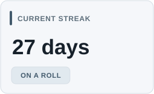
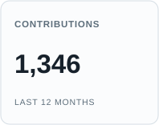
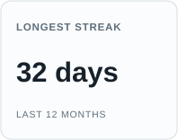
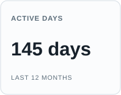

  <picture>
    <source media="(prefers-color-scheme: dark)" srcset="./assets/headers/hero-dark.svg">
    <source media="(prefers-color-scheme: light)" srcset="./assets/headers/hero-light.svg">
    
  </picture>

  
<samp>developer &nbsp;·&nbsp; business owner &nbsp;·&nbsp; independent builder &nbsp;·&nbsp; brazil</samp>

  

    <a href="#about">about</a> &nbsp;·&nbsp;
    <a href="#what-i-build">what i build</a> &nbsp;·&nbsp;
    <a href="#tech-stack--tools">toolbox</a> &nbsp;·&nbsp;
    <a href="#ai--coding-workflow">AI workflow</a> &nbsp;·&nbsp;
    <a href="#development-activity">activity</a>
  

 

### About

I'm Mello, a software developer, business owner and technology enthusiast from Brazil. I like turning ideas into useful software, understanding how things work, and paying attention to the details that make products feel right.

I'm especially interested in **developer experience, intelligent systems, automation, web platforms and thoughtful UI**. I build to solve practical problems, learn along the way and create things I'd genuinely want to use.

---

### What I build

   &nbsp; <strong>Developer tooling</strong> 
  CLIs, local-first utilities, developer platforms, diagnostics and workflow tools.

   &nbsp; <strong>Web applications &amp; product UI</strong> 
  Full-stack applications, polished dashboards, administrative interfaces and design systems.

   &nbsp; <strong>AI systems &amp; assistants</strong> 
  Intelligent agents, AI-assisted workflows, model integrations and practical AI solutions.

   &nbsp; <strong>Automation &amp; integrations</strong> 
  Bots, APIs, webhooks, messaging systems and connected services that simplify operations.

   &nbsp; <strong>Business software</strong> 
  Commerce, operations, finance, inventory and management systems built around real needs.

---

### Tech stack & tools

#### Languages

  <picture><source media="(prefers-color-scheme: dark)" srcset="./assets/chips/typescript-dark.svg"><source media="(prefers-color-scheme: light)" srcset="./assets/chips/typescript-light.svg"></picture>
  <picture><source media="(prefers-color-scheme: dark)" srcset="./assets/chips/javascript-dark.svg"><source media="(prefers-color-scheme: light)" srcset="./assets/chips/javascript-light.svg"></picture>
  <picture><source media="(prefers-color-scheme: dark)" srcset="./assets/chips/python-dark.svg"><source media="(prefers-color-scheme: light)" srcset="./assets/chips/python-light.svg"></picture>
  <picture><source media="(prefers-color-scheme: dark)" srcset="./assets/chips/sql-dark.svg"><source media="(prefers-color-scheme: light)" srcset="./assets/chips/sql-light.svg"></picture>

#### Frontend & UI

  <picture><source media="(prefers-color-scheme: dark)" srcset="./assets/chips/react-dark.svg"><source media="(prefers-color-scheme: light)" srcset="./assets/chips/react-light.svg"></picture>
  <picture><source media="(prefers-color-scheme: dark)" srcset="./assets/chips/nextjs-dark.svg"><source media="(prefers-color-scheme: light)" srcset="./assets/chips/nextjs-light.svg"></picture>
  <picture><source media="(prefers-color-scheme: dark)" srcset="./assets/chips/tailwindcss-dark.svg"><source media="(prefers-color-scheme: light)" srcset="./assets/chips/tailwindcss-light.svg"></picture>
  <picture><source media="(prefers-color-scheme: dark)" srcset="./assets/chips/shadcnui-dark.svg"><source media="(prefers-color-scheme: light)" srcset="./assets/chips/shadcnui-light.svg"></picture>
  <picture><source media="(prefers-color-scheme: dark)" srcset="./assets/chips/lucide-dark.svg"><source media="(prefers-color-scheme: light)" srcset="./assets/chips/lucide-light.svg"></picture>

#### Backend & Data

  <picture><source media="(prefers-color-scheme: dark)" srcset="./assets/chips/nodejs-dark.svg"><source media="(prefers-color-scheme: light)" srcset="./assets/chips/nodejs-light.svg"></picture>
  <picture><source media="(prefers-color-scheme: dark)" srcset="./assets/chips/fastify-dark.svg"><source media="(prefers-color-scheme: light)" srcset="./assets/chips/fastify-light.svg"></picture>
  <picture><source media="(prefers-color-scheme: dark)" srcset="./assets/chips/postgresql-dark.svg"><source media="(prefers-color-scheme: light)" srcset="./assets/chips/postgresql-light.svg"></picture>
  <picture><source media="(prefers-color-scheme: dark)" srcset="./assets/chips/sqlite-dark.svg"><source media="(prefers-color-scheme: light)" srcset="./assets/chips/sqlite-light.svg"></picture>
  <picture><source media="(prefers-color-scheme: dark)" srcset="./assets/chips/prisma-dark.svg"><source media="(prefers-color-scheme: light)" srcset="./assets/chips/prisma-light.svg"></picture>

#### Cloud & Infrastructure

  <picture><source media="(prefers-color-scheme: dark)" srcset="./assets/chips/docker-dark.svg"><source media="(prefers-color-scheme: light)" srcset="./assets/chips/docker-light.svg"></picture>
  <picture><source media="(prefers-color-scheme: dark)" srcset="./assets/chips/cloudflare-dark.svg"><source media="(prefers-color-scheme: light)" srcset="./assets/chips/cloudflare-light.svg"></picture>
  <picture><source media="(prefers-color-scheme: dark)" srcset="./assets/chips/workers-dark.svg"><source media="(prefers-color-scheme: light)" srcset="./assets/chips/workers-light.svg"></picture>

#### Developer Tools

  <picture><source media="(prefers-color-scheme: dark)" srcset="./assets/chips/git-dark.svg"><source media="(prefers-color-scheme: light)" srcset="./assets/chips/git-light.svg"></picture>
  <picture><source media="(prefers-color-scheme: dark)" srcset="./assets/chips/github-dark.svg"><source media="(prefers-color-scheme: light)" srcset="./assets/chips/github-light.svg"></picture>
  <picture><source media="(prefers-color-scheme: dark)" srcset="./assets/chips/githubactions-dark.svg"><source media="(prefers-color-scheme: light)" srcset="./assets/chips/githubactions-light.svg"></picture>
  <picture><source media="(prefers-color-scheme: dark)" srcset="./assets/chips/pnpm-dark.svg"><source media="(prefers-color-scheme: light)" srcset="./assets/chips/pnpm-light.svg"></picture>

---

### AI & coding workflow

#### Coding Agents & CLIs

  <picture><source media="(prefers-color-scheme: dark)" srcset="./assets/chips/codex-dark.svg"><source media="(prefers-color-scheme: light)" srcset="./assets/chips/codex-light.svg"></picture>
  <picture><source media="(prefers-color-scheme: dark)" srcset="./assets/chips/claude-code-dark.svg"><source media="(prefers-color-scheme: light)" srcset="./assets/chips/claude-code-light.svg"></picture>
  <picture><source media="(prefers-color-scheme: dark)" srcset="./assets/chips/antigravity-dark.svg"><source media="(prefers-color-scheme: light)" srcset="./assets/chips/antigravity-light.svg"></picture>
  <picture><source media="(prefers-color-scheme: dark)" srcset="./assets/chips/t3-code-dark.svg"><source media="(prefers-color-scheme: light)" srcset="./assets/chips/t3-code-light.svg"></picture>
  <picture><source media="(prefers-color-scheme: dark)" srcset="./assets/chips/opencode-dark.svg"><source media="(prefers-color-scheme: light)" srcset="./assets/chips/opencode-light.svg"></picture>

#### AI Platforms

  <picture><source media="(prefers-color-scheme: dark)" srcset="./assets/chips/chatgpt-dark.svg"><source media="(prefers-color-scheme: light)" srcset="./assets/chips/chatgpt-light.svg"></picture>
  <picture><source media="(prefers-color-scheme: dark)" srcset="./assets/chips/claude-dark.svg"><source media="(prefers-color-scheme: light)" srcset="./assets/chips/claude-light.svg"></picture>
  <picture><source media="(prefers-color-scheme: dark)" srcset="./assets/chips/gemini-dark.svg"><source media="(prefers-color-scheme: light)" srcset="./assets/chips/gemini-light.svg"></picture>
  <picture><source media="(prefers-color-scheme: dark)" srcset="./assets/chips/google-ai-studio-dark.svg"><source media="(prefers-color-scheme: light)" srcset="./assets/chips/google-ai-studio-light.svg"></picture>

---

### Development activity

  <picture><source media="(prefers-color-scheme: dark)" srcset="./assets/activity/streak-dark.svg"><source media="(prefers-color-scheme: light)" srcset="./assets/activity/streak-light.svg"></picture>
  <picture><source media="(prefers-color-scheme: dark)" srcset="./assets/activity/contributions-dark.svg"><source media="(prefers-color-scheme: light)" srcset="./assets/activity/contributions-light.svg"></picture>
  <picture><source media="(prefers-color-scheme: dark)" srcset="./assets/activity/longest-dark.svg"><source media="(prefers-color-scheme: light)" srcset="./assets/activity/longest-light.svg"></picture>
  <picture><source media="(prefers-color-scheme: dark)" srcset="./assets/activity/active-days-dark.svg"><source media="(prefers-color-scheme: light)" srcset="./assets/activity/active-days-light.svg"></picture>

<picture>
  <source media="(prefers-color-scheme: dark)" srcset="./assets/activity/calendar-dark.svg">
  <source media="(prefers-color-scheme: light)" srcset="./assets/activity/calendar-light.svg">
  
</picture>

---

  <h3>Always building something.</h3>
  
Interested in software, systems and the craft of making things.

  

    <a href="mailto:joaovdmello@gmail.com"> Email</a>
    &nbsp;·&nbsp;
    <a href="https://github.com/melloxyz?tab=repositories"> Repositories</a>
  

  MELLO / DEVELOPER SPACE

