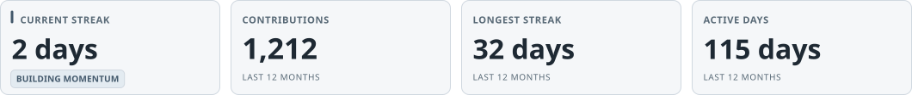

<picture>
  <source media="(max-width: 640px) and (prefers-color-scheme: dark)" srcset="./assets/headers/hero-mobile-dark.svg">
  <source media="(max-width: 640px)" srcset="./assets/headers/hero-mobile-light.svg">
  <source media="(prefers-color-scheme: dark)" srcset="./assets/headers/hero-dark.svg">
  
</picture>

I'm Mello, a developer and software enthusiast based in Brazil. I build practical tools, explore AI, and share open-source code. This is my personal lab for learning by making.

### Development activity

<picture>
  <source media="(max-width: 640px) and (prefers-color-scheme: dark)" srcset="./assets/activity/overview-mobile-dark.svg">
  <source media="(max-width: 640px)" srcset="./assets/activity/overview-mobile-light.svg">
  <source media="(prefers-color-scheme: dark)" srcset="./assets/activity/overview-dark.svg">
  
</picture>

<picture>
  <source media="(max-width: 640px) and (prefers-color-scheme: dark)" srcset="./assets/activity/monthly-mobile-dark.svg">
  <source media="(max-width: 640px)" srcset="./assets/activity/monthly-mobile-light.svg">
  <source media="(prefers-color-scheme: dark)" srcset="./assets/activity/monthly-dark.svg">
  
</picture>

Activity from GitHub, refreshed daily.

### Code, AI & open source

<picture>
  <source media="(max-width: 640px) and (prefers-color-scheme: dark)" srcset="./assets/sections/interests-mobile-dark.svg">
  <source media="(max-width: 640px)" srcset="./assets/sections/interests-mobile-light.svg">
  <source media="(prefers-color-scheme: dark)" srcset="./assets/sections/interests-dark.svg">
  
</picture>

I learn by building, follow my curiosity, and share what might be useful to someone else.

### Tools I reach for

<picture>
  <source media="(max-width: 640px) and (prefers-color-scheme: dark)" srcset="./assets/sections/stack-mobile-dark.svg">
  <source media="(max-width: 640px)" srcset="./assets/sections/stack-mobile-light.svg">
  <source media="(prefers-color-scheme: dark)" srcset="./assets/sections/stack-dark.svg">
  
</picture>

---

  <a href="https://github.com/melloxyz?tab=repositories"><strong>Explore my public repositories</strong></a>

  <a href="mailto:joaovdmello@gmail.com">Email</a>
  &nbsp; / &nbsp;
  <a href="https://x.com/mxrvit">X</a>
  &nbsp; / &nbsp;
  <a href="https://discord.com">Discord <code>mefrog</code></a>

