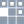
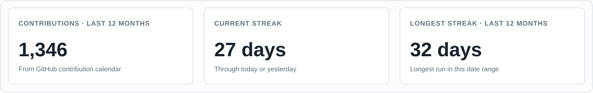

  <picture>
    <source media="(prefers-color-scheme: dark)" srcset="./assets/headers/hero-dark.svg">
    <source media="(prefers-color-scheme: light)" srcset="./assets/headers/hero-light.svg">
    
  </picture>

  
<samp>developer &nbsp;·&nbsp; business owner &nbsp;·&nbsp; independent builder &nbsp;·&nbsp; brazil</samp>

  

    <a href="#about">about</a> &nbsp;·&nbsp;
    <a href="#what-i-build">what i build</a> &nbsp;·&nbsp;
    <a href="#tech-stack--tools">toolbox</a> &nbsp;·&nbsp;
    <a href="#ai--coding-workflow">AI workflow</a> &nbsp;·&nbsp;
    <a href="#development-activity">activity</a>
  

 

### About

I'm Mello, a software developer, business owner and technology enthusiast from Brazil. I like turning ideas into useful software, understanding how things work, and paying attention to the details that make products feel right.

I'm especially interested in **developer experience, intelligent systems, automation, web platforms and thoughtful UI**. I build to solve practical problems, learn along the way and create things I'd genuinely want to use.

---

### What I build

   &nbsp; <strong>Developer tooling</strong> 
  CLIs, local-first utilities, developer platforms, diagnostics and workflow tools.

   &nbsp; <strong>Web applications &amp; product UI</strong> 
  Full-stack applications, polished dashboards, administrative interfaces and design systems.

   &nbsp; <strong>AI systems &amp; assistants</strong> 
  Intelligent agents, AI-assisted workflows, model integrations and practical AI solutions.

   &nbsp; <strong>Automation &amp; integrations</strong> 
  Bots, APIs, webhooks, messaging systems and connected services that simplify operations.

   &nbsp; <strong>Business software</strong> 
  Commerce, operations, finance, inventory and management systems built around real needs.

---

### Tech stack & tools

A curated overview of the languages, frameworks and tools in my development workflow.

<h4> &nbsp;Languages & foundations</h4>

The essentials I use to shape ideas and build reliable software.

   <code>TypeScript</code> &nbsp;&nbsp;
   <code>JavaScript</code> &nbsp;&nbsp;
   <code>Python</code> &nbsp;&nbsp;
   <code>HTML</code> &nbsp;&nbsp;
   <code>CSS</code> &nbsp;&nbsp;
   <code>SQL</code>

<h4> &nbsp;Web & product interfaces</h4>

Frontend frameworks, UI systems and tools for thoughtful interfaces.

   <code>React</code> &nbsp;&nbsp;
   <code>Next.js</code> &nbsp;&nbsp;
   <code>Vite</code> &nbsp;&nbsp;
   <code>Tailwind CSS</code> &nbsp;&nbsp;
   <code>Astro</code> &nbsp;&nbsp;
   <code>shadcn/ui</code> &nbsp;&nbsp;
   <code>Lucide</code>

<h4> &nbsp;Backend & databases</h4>

Application services, APIs, validation and data persistence.

   <code>Node.js</code> &nbsp;&nbsp;
   <code>Fastify</code> &nbsp;&nbsp;
   <code>PostgreSQL</code> &nbsp;&nbsp;
   <code>SQLite</code> &nbsp;&nbsp;
   <code>Prisma</code> &nbsp;&nbsp;
   <code>Zod</code>

<h4> &nbsp;Cloud & infrastructure</h4>

Environments, deployment and services behind the product.

   <code>Docker</code> &nbsp;&nbsp;
   <code>Cloudflare</code> &nbsp;&nbsp;
   <code>Workers</code> &nbsp;&nbsp;
   <code>D1</code> &nbsp;&nbsp;
   <code>R2</code>

<h4> &nbsp;Development & quality</h4>

The tools I reach for when developing, shipping and maintaining software.

   <code>Git</code> &nbsp;&nbsp;
   <code>GitHub</code> &nbsp;&nbsp;
   <code>GitHub Actions</code> &nbsp;&nbsp;
   <code>pnpm</code> &nbsp;&nbsp;
   <code>Sentry</code> &nbsp;&nbsp;
   <code>Playwright</code>

---

### AI & coding workflow

AI-powered coding is a practical part of how I explore, build and improve software. I work across different agents, models and environments rather than depending on a single tool.

<h4> &nbsp;Coding agents & CLIs</h4>

Tools I use to implement, review, debug and explore code.

   <code>Codex</code> &nbsp;&nbsp;
   <code>Claude Code</code> &nbsp;&nbsp;
   <code>Antigravity</code> &nbsp;&nbsp;
   <code>T3 Code</code> &nbsp;&nbsp;
   <code>OpenCode</code> &nbsp;&nbsp;
   <code>Gemini CLI</code> &nbsp;&nbsp;
   <code>Kimi CLI</code> &nbsp;&nbsp;
   <code>Qwen CLI</code>

<h4> &nbsp;Models & AI platforms</h4>

Interfaces and model providers I use across different workflows.

   <code>ChatGPT</code> &nbsp;&nbsp;
   <code>Claude</code> &nbsp;&nbsp;
   <code>Gemini</code> &nbsp;&nbsp;
   <code>Google AI Studio</code> &nbsp;&nbsp;
   <code>OpenRouter</code>

<h4> &nbsp;Protocols & utilities</h4>

The supporting tools that connect agents, environments and local workflows.

   <code>MCP</code> &nbsp;&nbsp;
   <code>Agent skills</code> &nbsp;&nbsp;
   <code>RTK</code> &nbsp;&nbsp;
   <code>Graphify</code>

---

### Development activity

GitHub contribution counts and streaks are generated from actual GitHub data. Private contributions may be included as aggregates if enabled in GitHub settings. Longest streak is calculated within the last 12 months.

<picture>
  <source media="(prefers-color-scheme: dark)" srcset="./assets/activity/metrics-dark.svg">
  <source media="(prefers-color-scheme: light)" srcset="./assets/activity/metrics-light.svg">
  
</picture>

<picture>
  <source media="(prefers-color-scheme: dark)" srcset="./assets/activity/calendar-dark.svg">
  <source media="(prefers-color-scheme: light)" srcset="./assets/activity/calendar-light.svg">
  
</picture>

Automatically refreshed each day using [GitHub Actions](./.github/workflows/profile-activity.yml). These figures are based on the GitHub contribution calendar, not raw commit counts.

---

  <h3>Always building something.</h3>
  
Interested in software, systems and the craft of making things.

  

    <a href="mailto:joaovdmello@gmail.com"> Email</a>
    &nbsp;·&nbsp;
    <a href="https://github.com/melloxyz?tab=repositories"> Repositories</a>
  

  MELLO / DEVELOPER SPACE

