<picture>
  <source media="(prefers-color-scheme: dark)" srcset="./assets/headers/hero-dark.svg">
  
</picture>

I build tools, explore new ideas, and share open-source code. Always curious about what I can make next.

<picture>
  <source media="(prefers-color-scheme: dark)" srcset="./assets/activity/overview-dark.svg">
  
</picture>

**Working with** TypeScript, Python, React, Node.js, and Cloudflare.

<a href="https://github.com/melloxyz?tab=repositories">Open source</a> &nbsp; / &nbsp; <a href="mailto:joaovdmello@gmail.com">Email</a> &nbsp; / &nbsp; <a href="https://x.com/mxrvit">X</a> &nbsp; / &nbsp; <a href="https://discord.com">Discord <code>mefrog</code></a>
