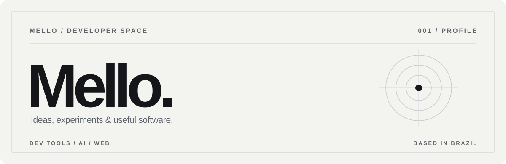

  <picture>
    <source media="(prefers-color-scheme: dark)" srcset="./assets/profile-header-dark.svg">
    <source media="(prefers-color-scheme: light)" srcset="./assets/profile-header-light.svg">
    
  </picture>

  
<samp>developer by curiosity. maker by habit.</samp>

  

    <a href="#about">about</a> &nbsp;·&nbsp;
    <a href="#selected-work">projects</a> &nbsp;·&nbsp;
    <a href="#toolbox">toolbox</a> &nbsp;·&nbsp;
    <a href="#elsewhere">elsewhere</a>
  

 

### About

I'm Mello, a software developer and tech enthusiast from Brazil. I like taking an idea, figuring out how it could work, and turning it into something real.

A lot of what I build starts with curiosity: **developer tools, AI experiments, web apps, and small products I'd genuinely want to use.** I'm especially interested in the details that make software useful, fast, and pleasant to interact with.

I enjoy learning in public, iterating on things, and occasionally starting a new side project before the previous one is really finished.

### Selected work

<table>
  <tr>
    <td width="50%" valign="top">
      <strong><a href="https://github.com/melloxyz/sessionlens">Sessionlens</a></strong> 
      Local-first observability for AI coding tools. Explore sessions, tokens, and costs without sending data to a cloud service.  
      TypeScript · React · Fastify · SQLite
    </td>
    <td width="50%" valign="top">
      <strong><a href="https://github.com/melloxyz/openpkg-cli">OpenPkg</a></strong> 
      A terminal-based control center for inspecting projects, managing development environments, and handling cleanup safely.  
      TypeScript · Node.js · React · Ink
    </td>
  </tr>
  <tr>
    <td width="50%" valign="top">
      <strong><a href="https://github.com/melloxyz/kern">KERN.</a></strong> 
      A minimal editorial project focused on making AI news and technical information easier to follow.  
      Astro · TypeScript · Editorial design
    </td>
    <td width="50%" valign="top">
      <strong><a href="https://github.com/melloxyz/Conecta">Conecta+</a></strong> 
      An accessible web app designed to help older adults learn everyday digital skills with step-by-step guides.  
      React · TypeScript · PWA · Accessibility
    </td>
  </tr>
</table>

A few more things I've explored: [Select.ai](https://github.com/melloxyz/select-ai), [DevProfile](https://github.com/melloxyz/DevProfile), and [other repositories](https://github.com/melloxyz?tab=repositories).

### Toolbox

**Mostly working with**  
`TypeScript` · `JavaScript` · `Node.js` · `React` · `Fastify` · `SQL`

**Also exploring**  
`Python` · `Docker` · `Cloudflare` · `AI tooling` · `UI/UX`

### Elsewhere

[LinkedIn](https://www.linkedin.com/in/mellodev-/) &nbsp;·&nbsp; [Email](mailto:joaovdmello@gmail.com) &nbsp;·&nbsp; [All projects](https://github.com/melloxyz?tab=repositories)

---

  Building things, learning along the way.

