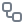
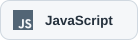
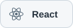
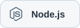
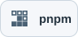

  <picture>
    <source media="(max-width: 640px) and (prefers-color-scheme: dark)" srcset="./assets/headers/hero-mobile-dark.svg">
    <source media="(max-width: 640px) and (prefers-color-scheme: light)" srcset="./assets/headers/hero-mobile-light.svg">
    <source media="(prefers-color-scheme: dark)" srcset="./assets/headers/hero-dark.svg">
    <source media="(prefers-color-scheme: light)" srcset="./assets/headers/hero-light.svg">
    
  </picture>

  
<samp>developer &nbsp;·&nbsp; business owner &nbsp;·&nbsp; independent builder &nbsp;·&nbsp; brazil</samp>

  

    <a href="#about">about</a> &nbsp;·&nbsp;
    <a href="#what-i-build">what i build</a> &nbsp;·&nbsp;
    <a href="#tech-stack--tools">toolbox</a> &nbsp;·&nbsp;
    <a href="#ai--coding-workflow">AI workflow</a> &nbsp;·&nbsp;
    <a href="#development-activity">activity</a>
  

 

### About

I'm Mello, an independent software developer and business owner based in Brazil. I turn ideas into useful software, with an emphasis on clarity, reliability and good design.

My interests lie in **web platforms, developer tools, intelligent systems and automation**. I enjoy solving practical problems and building interfaces that feel natural to use.

---

### What I build

   &nbsp; <strong>Developer tooling</strong> 
  CLIs, local utilities and workflows that simplify development.

   &nbsp; <strong>Web applications &amp; product UI</strong> 
  Full-stack products, dashboards and carefully designed interfaces.

   &nbsp; <strong>AI systems &amp; assistants</strong> 
  Agents and model-powered workflows for practical applications.

   &nbsp; <strong>Automation &amp; integrations</strong> 
  Bots, APIs, webhooks and connected services that reduce repetitive work.

   &nbsp; <strong>Business software</strong> 
  Platforms for commerce, operations, finance and management.

---

### Tech Stack & Tools

**Languages**

  <picture><source media="(prefers-color-scheme: dark)" srcset="./assets/chips/typescript-dark.svg"><source media="(prefers-color-scheme: light)" srcset="./assets/chips/typescript-light.svg"></picture>
  <picture><source media="(prefers-color-scheme: dark)" srcset="./assets/chips/javascript-dark.svg"><source media="(prefers-color-scheme: light)" srcset="./assets/chips/javascript-light.svg"></picture>
  <picture><source media="(prefers-color-scheme: dark)" srcset="./assets/chips/python-dark.svg"><source media="(prefers-color-scheme: light)" srcset="./assets/chips/python-light.svg"></picture>
  <picture><source media="(prefers-color-scheme: dark)" srcset="./assets/chips/sql-dark.svg"><source media="(prefers-color-scheme: light)" srcset="./assets/chips/sql-light.svg"></picture>

**Frontend & UI**

  <picture><source media="(prefers-color-scheme: dark)" srcset="./assets/chips/react-dark.svg"><source media="(prefers-color-scheme: light)" srcset="./assets/chips/react-light.svg"></picture>
  <picture><source media="(prefers-color-scheme: dark)" srcset="./assets/chips/nextjs-dark.svg"><source media="(prefers-color-scheme: light)" srcset="./assets/chips/nextjs-light.svg"></picture>
  <picture><source media="(prefers-color-scheme: dark)" srcset="./assets/chips/tailwindcss-dark.svg"><source media="(prefers-color-scheme: light)" srcset="./assets/chips/tailwindcss-light.svg"></picture>
  <picture><source media="(prefers-color-scheme: dark)" srcset="./assets/chips/shadcnui-dark.svg"><source media="(prefers-color-scheme: light)" srcset="./assets/chips/shadcnui-light.svg"></picture>
  <picture><source media="(prefers-color-scheme: dark)" srcset="./assets/chips/lucide-dark.svg"><source media="(prefers-color-scheme: light)" srcset="./assets/chips/lucide-light.svg"></picture>

**Backend & Data**

  <picture><source media="(prefers-color-scheme: dark)" srcset="./assets/chips/nodejs-dark.svg"><source media="(prefers-color-scheme: light)" srcset="./assets/chips/nodejs-light.svg"></picture>
  <picture><source media="(prefers-color-scheme: dark)" srcset="./assets/chips/fastify-dark.svg"><source media="(prefers-color-scheme: light)" srcset="./assets/chips/fastify-light.svg"></picture>
  <picture><source media="(prefers-color-scheme: dark)" srcset="./assets/chips/postgresql-dark.svg"><source media="(prefers-color-scheme: light)" srcset="./assets/chips/postgresql-light.svg"></picture>
  <picture><source media="(prefers-color-scheme: dark)" srcset="./assets/chips/sqlite-dark.svg"><source media="(prefers-color-scheme: light)" srcset="./assets/chips/sqlite-light.svg"></picture>
  <picture><source media="(prefers-color-scheme: dark)" srcset="./assets/chips/prisma-dark.svg"><source media="(prefers-color-scheme: light)" srcset="./assets/chips/prisma-light.svg"></picture>

**Cloud & Infrastructure**

  <picture><source media="(prefers-color-scheme: dark)" srcset="./assets/chips/docker-dark.svg"><source media="(prefers-color-scheme: light)" srcset="./assets/chips/docker-light.svg"></picture>
  <picture><source media="(prefers-color-scheme: dark)" srcset="./assets/chips/cloudflare-dark.svg"><source media="(prefers-color-scheme: light)" srcset="./assets/chips/cloudflare-light.svg"></picture>
  <picture><source media="(prefers-color-scheme: dark)" srcset="./assets/chips/workers-dark.svg"><source media="(prefers-color-scheme: light)" srcset="./assets/chips/workers-light.svg"></picture>

**Developer Tools**

  <picture><source media="(prefers-color-scheme: dark)" srcset="./assets/chips/git-dark.svg"><source media="(prefers-color-scheme: light)" srcset="./assets/chips/git-light.svg"></picture>
  <picture><source media="(prefers-color-scheme: dark)" srcset="./assets/chips/github-dark.svg"><source media="(prefers-color-scheme: light)" srcset="./assets/chips/github-light.svg"></picture>
  <picture><source media="(prefers-color-scheme: dark)" srcset="./assets/chips/githubactions-dark.svg"><source media="(prefers-color-scheme: light)" srcset="./assets/chips/githubactions-light.svg"></picture>
  <picture><source media="(prefers-color-scheme: dark)" srcset="./assets/chips/pnpm-dark.svg"><source media="(prefers-color-scheme: light)" srcset="./assets/chips/pnpm-light.svg"></picture>

---

### AI & Coding Workflow

**Coding Agents & CLIs**

  <picture><source media="(prefers-color-scheme: dark)" srcset="./assets/chips/codex-dark.svg"><source media="(prefers-color-scheme: light)" srcset="./assets/chips/codex-light.svg"></picture>
  <picture><source media="(prefers-color-scheme: dark)" srcset="./assets/chips/claude-code-dark.svg"><source media="(prefers-color-scheme: light)" srcset="./assets/chips/claude-code-light.svg"></picture>
  <picture><source media="(prefers-color-scheme: dark)" srcset="./assets/chips/antigravity-dark.svg"><source media="(prefers-color-scheme: light)" srcset="./assets/chips/antigravity-light.svg"></picture>
  <picture><source media="(prefers-color-scheme: dark)" srcset="./assets/chips/t3-code-dark.svg"><source media="(prefers-color-scheme: light)" srcset="./assets/chips/t3-code-light.svg"></picture>
  <picture><source media="(prefers-color-scheme: dark)" srcset="./assets/chips/opencode-dark.svg"><source media="(prefers-color-scheme: light)" srcset="./assets/chips/opencode-light.svg"></picture>

---

### Development Activity

<picture>
  <source media="(max-width: 640px) and (prefers-color-scheme: dark)" srcset="./assets/activity/overview-mobile-dark.svg">
  <source media="(max-width: 640px) and (prefers-color-scheme: light)" srcset="./assets/activity/overview-mobile-light.svg">
  <source media="(prefers-color-scheme: dark)" srcset="./assets/activity/overview-dark.svg">
  <source media="(prefers-color-scheme: light)" srcset="./assets/activity/overview-light.svg">
  
</picture>

<picture>
  <source media="(max-width: 640px) and (prefers-color-scheme: dark)" srcset="./assets/activity/calendar-mobile-dark.svg">
  <source media="(max-width: 640px) and (prefers-color-scheme: light)" srcset="./assets/activity/calendar-mobile-light.svg">
  <source media="(prefers-color-scheme: dark)" srcset="./assets/activity/calendar-dark.svg">
  <source media="(prefers-color-scheme: light)" srcset="./assets/activity/calendar-light.svg">
  
</picture>

---

  <h3>Always building something.</h3>
  
Software, systems and the craft of making things.

  

    <a href="mailto:joaovdmello@gmail.com"> Email</a>
    &nbsp;&nbsp;·&nbsp;&nbsp;
    <a href="https://github.com/melloxyz?tab=repositories"> Repositories</a>
    &nbsp;&nbsp;·&nbsp;&nbsp;
    <a href="https://x.com/mxrvit"> X / @mxrvit</a>
    &nbsp;&nbsp;·&nbsp;&nbsp;
     Discord <code>mefrog</code>
  

  MELLO / DEVELOPER SPACE

